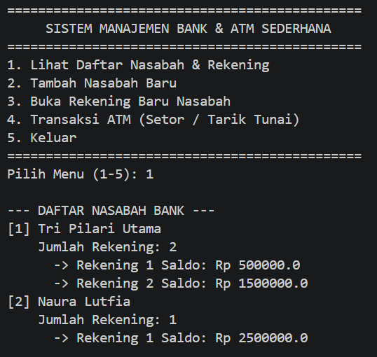
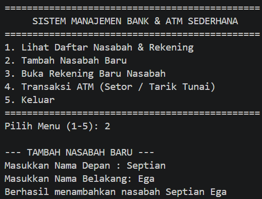
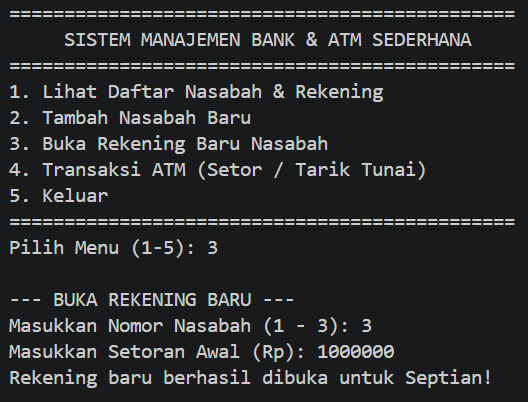
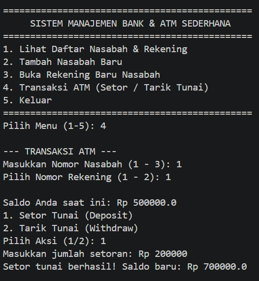
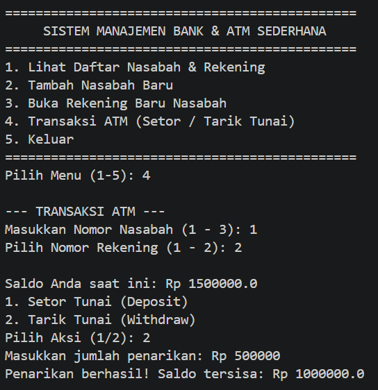
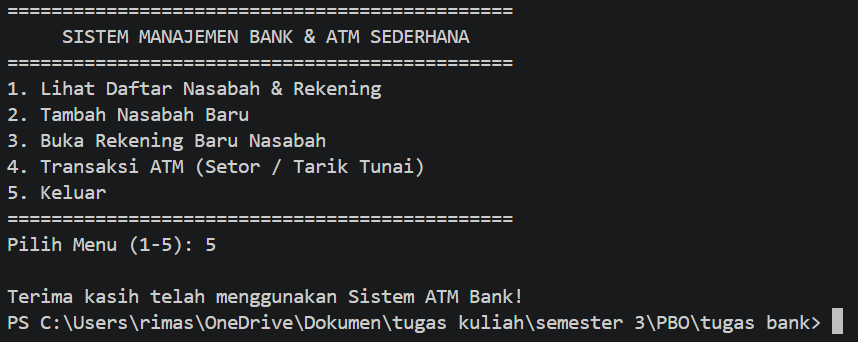

# Latihan/Eksplorasi Materi Array dan ArrayList (Sistem Bank & ATM)

Repositori ini berisi implementasi program Java berkonsep **Object-Oriented Programming (OOP)** untuk pemodelan Sistem Perbankan dan ATM Sederhana yang mengelola asosiasi objek melalui **Array**

---

## 📌 Penjelasan Struktur Kode & Kelas

1. **`Account`**:
   - Menyimpan informasi saldo (`balance`).
   - Menyediakan metode `deposit(amount)` dan `withdraw(amount)` dengan verifikasi keabsahan nominal dan sisa saldo[cite: 134].
2. **`Customer`**:
   - Menyimpan nama nasabah (`firstName`, `lastName`).
   - Menggunakan objek **Array** (`Account[]`) untuk menampung hingga 5 rekening per nasabah.
3. **`Bank`**:
   - Mengelola sekumpulan nasabah perbankan menggunakan **Array** (`Customer[]`).
   - Menyediakan fungsi penambahan nasabah dan pencarian nasabah berdasarkan indeks.
4. **`Main`**:
   - Merupakan antarmuka interaktif CLI yang mengeksplorasi fungsi-fungsi sistem ATM seperti:
     * Menampilkan daftar nasabah dan daftar saldo rekening.
     * Pendaftaran nasabah dan pembukaan rekening baru.
     * Transaksi ATM (Setor & Tarik Tunai).

---

## 🛠️ Library yang Digunakan

- `java.util.Scanner`: Digunakan untuk menerima masukan interaktif dari pengguna (*console input*).

---

## 📸 Screenshot Hasil Eksekusi Program

---